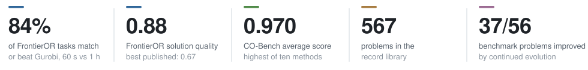
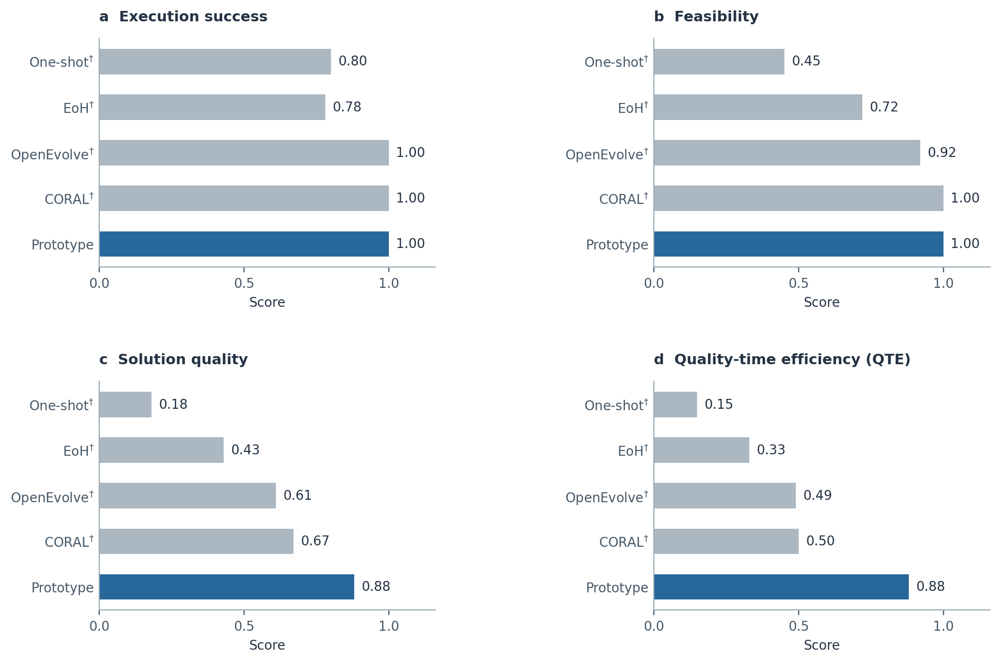
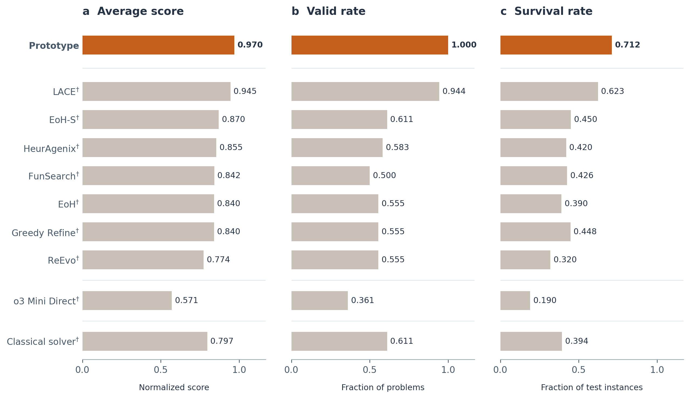

<h1 align="center">LLM-Driven Algorithm Construction: Preliminary Results</h1>

<p align="center">
  Preliminary results for the research proposal<br>
  <b>Self-Evolving LLM Algorithm Discovery for Singapore's Maritime Operations</b>
</p>

<p align="center">
  <a href="https://colab.research.google.com/github/PJ-NTU/llm-algorithm-construction-results/blob/main/notebooks/reproduce.ipynb"></a>
  
  
</p>

<picture>
  <source media="(prefers-color-scheme: dark)" srcset="docs/assets/overview-dark.svg">
  
</picture>

<picture>
  <source media="(prefers-color-scheme: dark)" srcset="docs/assets/key-numbers-dark.svg">
  
</picture>

This repository shows what our prototype produced for **56 benchmark problems** (20 FrontierOR tasks and 36 CO-Bench
problems). For each problem it contains the mathematical formulation, feasibility checker, objective, evaluation
instances and evolved algorithms that the prototype built from a natural-language description, together with
per-instance results on the official benchmark instances. Every algorithm can be run in the browser with
[Google Colab](https://colab.research.google.com/github/PJ-NTU/llm-algorithm-construction-results/blob/main/notebooks/reproduce.ipynb), without installation or an API key.

**Contents:** [How the prototype works](#how-the-prototype-works) ·
[Results](#results) · [Run the algorithms](#run-the-algorithms) ·
[The 56 problems](#the-56-problems) · [Repository layout](#repository-layout)

## How the prototype works

**1. Construction** (proposal, Aim 1). From a natural-language description alone, the prototype builds the
mathematical formulation, feasibility check and objective (Module 1), constructs evaluation instances that are
verified to be feasible (Module 2), and generates, evaluates and selects a complementary portfolio of algorithms
(Module 3).

<picture>
  <source media="(prefers-color-scheme: dark)" srcset="docs/assets/fig1a-dark.svg">
  
</picture>

In each generation, six operators each propose one candidate, and complementary selection keeps the *k* algorithms
whose best rank on each instance is lowest on average.

<picture>
  <source media="(prefers-color-scheme: dark)" srcset="docs/assets/fig1b-dark.svg">
  
</picture>

When runs fail, the pattern of failures directs review to the module responsible.

<picture>
  <source media="(prefers-color-scheme: dark)" srcset="docs/assets/fig1c-dark.svg">
  
</picture>

**2. Reuse** (proposal, Aim 3). Each result is stored as a reusable record together with the problem it was built
for, so that a new description can be matched to it and the stored algorithms returned without rebuilding them.

<picture>
  <source media="(prefers-color-scheme: dark)" srcset="docs/assets/fig2ab-dark.svg">
  
</picture>

**3. Continued evolution** (proposal, Aim 3). Newer LLMs continue from the stored algorithms; a candidate is kept only
if it beats its predecessors under the same evaluation.

<picture>
  <source media="(prefers-color-scheme: dark)" srcset="docs/assets/fig2c-dark.svg">
  
</picture>

## Results

### FrontierOR

On the 20 hardest FrontierOR tasks (five official large instances each), the prototype's algorithms, given 60 s per
instance, returned feasible solutions for all 100 instances and reached a solution-quality score of **0.88**, against
0.67 for the best published method. Across all 179 FrontierOR tasks, they matched or beat Gurobi's one-hour solutions
on **142 of the 169 tasks** that have a valid Gurobi reference (84%).



<sub>† Values quoted from FrontierOR (Kong et al., 2026); these methods also used the official input and output
formats and development-set feedback.</sub>

### CO-Bench

On the 36 classical problems of CO-Bench, the prototype achieved the highest average score (**0.970**), valid rate
(1.000) and survival rate (0.712) among ten methods, including LACE (Gong et al., *Nature Machine Intelligence*, 2026).



<sub>† Values reported in the CO-Bench and LACE publications.</sub>

The per-instance results behind both figures are in [`results/data/`](results/data/) as CSV and JSON; the columns
are defined in [`results/README.md`](results/README.md).

## Run the algorithms

### In the browser (Google Colab)

[**Open the notebook in Colab**](https://colab.research.google.com/github/PJ-NTU/llm-algorithm-construction-results/blob/main/notebooks/reproduce.ipynb). Choose a FrontierOR task or a CO-Bench problem, and the notebook

1. downloads the official benchmark instances, pinned to the dataset revisions used for the recorded results;
2. runs the prototype's algorithms on them under the recorded time limits (60 s per FrontierOR instance, 10 s per
   CO-Bench instance);
3. checks each solution with the official checker;
4. prints the outcome next to the recorded value for each instance.

Time-limited search is not exactly deterministic, so individual runs can differ slightly from the recorded values.

### On your own machine

```sh
git clone https://github.com/PJ-NTU/llm-algorithm-construction-results.git
cd llm-algorithm-construction-results
python3 -m venv .venv && source .venv/bin/activate
pip install -r requirements.txt && python setup_runtime.py
```

Then open [`notebooks/reproduce.ipynb`](notebooks/reproduce.ipynb) in Jupyter or VS Code. The command-line
harnesses are described in [`frontieror/README.md`](frontieror/README.md) and [`cobench/README.md`](cobench/README.md).

## The 56 problems

Each problem folder holds what the prototype built from the problem's description:

- `formulation.md`: the mathematical formulation (decision variables, constraints, objective, data fields);
- `input_format.json`, `output_format.json`: the input and output schemas;
- `checker.py`, `objective.py`: the feasibility check and the objective evaluation;
- `instances/`: the evaluation instances the prototype generated;
- `algorithms/`: the algorithm portfolio;
- `adapter.py` (FrontierOR) or `cobench/harness/` (CO-Bench): conversion between the official format and the
  prototype's format.

For 49 of the 56 problems, the portfolio in the folder is the one after continued evolution with a newer LLM; the
result tables record the algorithms that produced the values above (see [`results/README.md`](results/README.md)).

### FrontierOR (20 tasks, five official large instances each)

| # | Task | Problem | Feasible instances | Within 1% of Gurobi or better | Better than Gurobi | Algorithms |
|---|---|---|---|---|---|---|
| 01 | [`adulyasak2015`](frontieror/01_adulyasak2015) | Stochastic production routing | 5/5 | 5/5 | 5 | 5 |
| 02 | [`archetti2007`](frontieror/02_archetti2007) | Inventory routing | 5/5 | 4/4 | 0 | 5 |
| 03 | [`armbruster2012`](frontieror/03_armbruster2012) | Bidirectional-capacity min-cut graph partitioning | 5/5 | 2/5 | 2 | 5 |
| 04 | [`bard2002`](frontieror/04_bard2002) | Vehicle routing with time windows | 5/5 | 5/5 | 5 | 5 |
| 05 | [`bertsimas2022`](frontieror/05_bertsimas2022) | Cardinality-constrained MIQP portfolio selection | 5/5 | 5/5 | 5 | 5 |
| 06 | [`bront2009`](frontieror/06_bront2009) | Choice-based network revenue management | 5/5 | 5/5 | 0 | 5 |
| 07 | [`carvalho1999`](frontieror/07_carvalho1999) | Bin packing (minimum number of bins) | 5/5 | 5/5 | 0 | 5 |
| 08 | [`desaulniers2014`](frontieror/08_desaulniers2014) | Production routing | 5/5 | 2/5 | 2 | 5 |
| 09 | [`desaulniers2016`](frontieror/09_desaulniers2016) | Finite-horizon inventory routing | 5/5 | 4/5 | 3 | 5 |
| 10 | [`furini2021`](frontieror/10_furini2021) | Edge-interdiction clique problem | 5/5 | 5/5 | 0 | 5 |
| 11 | [`kobeaga2024`](frontieror/11_kobeaga2024) | Orienteering (score maximization) | 5/5 | 4/5 | 4 | 5 |
| 12 | [`mehrotra1996`](frontieror/12_mehrotra1996) | Graph coloring | 5/5 | 4/5 | 2 | 5 |
| 13 | [`nagy2015`](frontieror/13_nagy2015) | Split delivery and pickup vehicle routing | 5/5 | 5/5 | 5 | 5 |
| 14 | [`pedersen2024`](frontieror/14_pedersen2024) | Wind farm quota Steiner tree | 5/5 | 3/5 | 0 | 5 |
| 15 | [`pinnoi1997`](frontieror/15_pinnoi1997) | Assembly line balancing | 5/5 | 2/2 | 0 | 4 |
| 16 | [`roberti2018`](frontieror/16_roberti2018) | Two-echelon CVRP with cluster constraints | 5/5 | 4/4 | 1 | 5 |
| 17 | [`rostami2021`](frontieror/17_rostami2021) | Stochastic single-allocation hub location | 5/5 | 5/5 | 0 | 5 |
| 18 | [`schwerdfeger2016`](frontieror/18_schwerdfeger2016) | Parallel-machine workload balancing (NSSWD) | 5/5 | 5/5 | 0 | 5 |
| 19 | [`wangk2020`](frontieror/19_wangk2020) | Flight planning under weather uncertainty | 5/5 | 5/5 | 0 | 5 |
| 20 | [`watermeyer2020`](frontieror/20_watermeyer2020) | RCPSP/max with partial information | 5/5 | 5/5 | 5 | 5 |

### CO-Bench (36 problems)

| # | Problem | Category | Instances | Average score | Survival rate | LACE average score | Algorithms |
|---|---|---|---|---|---|---|---|
| 01 | [Aircraft Landing](cobench/01_aircraft_landing) | Scheduling Problems | 49 | 0.978 | 0.898 | 0.901 | 5 |
| 02 | [Assignment Problem](cobench/02_assignment_problem) | Location & Assignment | 12 | 1.000 | 1.000 | 0.963 | 5 |
| 03 | [Assortment Problem](cobench/03_assortment_problem) | Selection & Knapsack | 12 | 0.651 | 0.167 | 0.345 | 5 |
| 04 | [Bin Packing - One-Dimensional](cobench/04_bin_packing_one_dimensional) | Packing & Cutting | 160 | 0.977 | 0.500 | 0.988 | 10 |
| 05 | [Capacitated Warehouse Location](cobench/05_capacitated_warehouse_location) | Location & Assignment | 49 | 0.993 | 0.755 | 0.998 | 5 |
| 06 | [Common Due Date Scheduling](cobench/06_common_due_date_scheduling) | Scheduling Problems | 70 | 0.981 | 0.457 | 0.980 | 5 |
| 07 | [Constrained Guillotine Cutting](cobench/07_constrained_guillotine_cutting) | Packing & Cutting | 3 | 1.000 | 1.000 | 1.000 | 10 |
| 08 | [Constrained Non-Guillotine Cutting](cobench/08_constrained_non_guillotine_cutting) | Packing & Cutting | 650 | 0.994 | 0.832 | 0.985 | 5 |
| 09 | [Container Loading](cobench/09_container_loading) | Packing & Cutting | 762 | 0.997 | 0.975 | 0.983 | 5 |
| 10 | [Container Loading with Weight Restrictions](cobench/10_container_loading_with_weight_restrictions) | Packing & Cutting | 700 | 0.996 | 0.976 | 0.943 | 5 |
| 11 | [Corporate Structuring](cobench/11_corporate_structuring) | Selection & Knapsack | 10 | 0.983 | 0.600 | 1.000 | 5 |
| 12 | [Crew Scheduling](cobench/12_crew_scheduling) | Scheduling Problems | 34 | 0.970 | 0.382 | 0.959 | 5 |
| 13 | [Equitable Partitioning Problem](cobench/13_equitable_partitioning_problem) | Selection & Knapsack | 10 | 1.000 | 1.000 | 1.000 | 5 |
| 14 | [Euclidean Steiner Problem](cobench/14_euclidean_steiner_problem) | Routing & Graphs | 234 | 0.986 | 0.714 | 0.879 | 5 |
| 15 | [Flow Shop Scheduling](cobench/15_flow_shop_scheduling) | Scheduling Problems | 120 | 0.954 | 0.192 | 0.987 | 5 |
| 16 | [Generalised Assignment Problem](cobench/16_generalised_assignment_problem) | Location & Assignment | 24 | 0.999 | 1.000 | 0.995 | 5 |
| 17 | [Graph Colouring](cobench/17_graph_colouring) | Routing & Graphs | 30 | 1.000 | 1.000 | 0.929 | 5 |
| 18 | [Hybrid Reentrant Shop Scheduling](cobench/18_hybrid_reentrant_shop_scheduling) | Scheduling Problems | 1350 | 0.976 | 0.570 | 0.976 | 10 |
| 19 | [Job Shop Scheduling](cobench/19_job_shop_scheduling) | Scheduling Problems | 80 | 0.895 | 0.225 | 0.888 | 5 |
| 20 | [Maximal Independent Set](cobench/20_maximal_independent_set) | Routing & Graphs | 244 | 0.970 | 0.082 | 0.937 | 10 |
| 21 | [Multi-Demand Multidimensional Knapsack Problem](cobench/21_multi_demand_multidimensional_knapsack_problem) | Selection & Knapsack | 785 | 0.954 | 0.307 | 0.956 | 5 |
| 22 | [Multidimensional Knapsack Problem](cobench/22_multidimensional_knapsack_problem) | Selection & Knapsack | 192 | 0.992 | 0.885 | 0.984 | 5 |
| 23 | [Open Shop Scheduling](cobench/23_open_shop_scheduling) | Scheduling Problems | 60 | 0.990 | 0.667 | 0.989 | 5 |
| 24 | [P-Median - Capacitated](cobench/24_p_median_capacitated) | Location & Assignment | 20 | 1.000 | 1.000 | 0.989 | 5 |
| 25 | [P-Median - Uncapacitated](cobench/25_p_median_uncapacitated) | Location & Assignment | 40 | 1.000 | 1.000 | 0.999 | 5 |
| 26 | [Packing Unequal Circles](cobench/26_packing_unequal_circles) | Packing & Cutting | 4 | 1.000 | 1.000 | 0.972 | 5 |
| 27 | [Packing Unequal Circles Area](cobench/27_packing_unequal_circles_area) | Packing & Cutting | 4 | 1.000 | 1.000 | 0.972 | 5 |
| 28 | [Packing Unequal Rectangles and Squares](cobench/28_packing_unequal_rectangles_and_squares) | Packing & Cutting | 6 | 1.000 | 1.000 | 1.000 | 5 |
| 29 | [Packing Unequal Rectangles and Squares Area](cobench/29_packing_unequal_rectangles_and_squares_area) | Packing & Cutting | 6 | 1.000 | 1.000 | 0.992 | 5 |
| 30 | [Resource Constrained Shortest Path](cobench/30_resource_constrained_shortest_path) | Routing & Graphs | 23 | 0.832 | 0.478 | 0.832 | 3 |
| 31 | [Set Covering](cobench/31_set_covering) | Selection & Knapsack | 33 | 0.979 | 0.909 | 0.979 | 5 |
| 32 | [Set Partitioning](cobench/32_set_partitioning) | Selection & Knapsack | 57 | 0.971 | 0.737 | 0.984 | 5 |
| 33 | [Travelling Salesman Problem](cobench/33_travelling_salesman_problem) | Routing & Graphs | 272 | 0.957 | 0.000 | 0.892 | 5 |
| 34 | [Uncapacitated Warehouse Location](cobench/34_uncapacitated_warehouse_location) | Location & Assignment | 15 | 1.000 | 1.000 | 0.997 | 5 |
| 35 | [Vehicle Routing - Period Routing](cobench/35_vehicle_routing_period_routing) | Routing & Graphs | 9 | 1.000 | 1.000 | 0.928 | 5 |
| 36 | [Unconstrained Guillotine Cutting](cobench/36_unconstrained_guillotine_cutting) | Packing & Cutting | 26 | 0.957 | 0.308 | – | 5 |

## Repository layout

```
frontieror/<task>/      20 FrontierOR tasks: formulation, checker, objective, instances, algorithms, adapter
frontieror/harness/     download the official data, run and score the algorithms
cobench/<problem>/      36 CO-Bench problems, same layout
cobench/harness/        adapters to the official CO-Bench format and the evaluation harness
results/data/           per-instance and per-problem results (CSV and JSON)
notebooks/              the Colab notebook and its helpers
docs/assets/            figures used in this README
```

The construction system itself and its prompts are not released at this stage.

---

<sub>© 2026 Huatian Gong. All rights reserved. This repository is shared for the review of the research proposal named
above; please contact the author before reusing its code or data.</sub>
